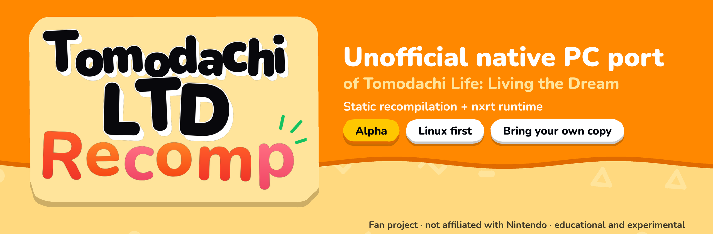
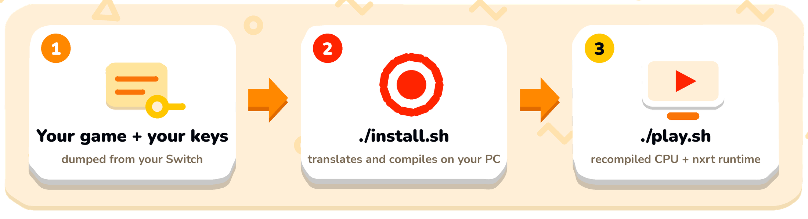

<h1 align="center">
  
</h1>

**Alpha: an unofficial native PC port of Tomodachi Life: Living the Dream, built on your computer from your own copy of the game.** The game's ARM code is statically recompiled to x86-64 and runs on **nxrt**, this project's own runtime, with its own NVN → Vulkan renderer. Parts of the Switch system services still come from suyu-derived code, so this is **not a from-scratch rewrite**.

This project **does not contain the game, firmware or keys**. You bring **your own copy** and your own `prod.keys`; the installer builds everything on your computer. This is a fan project, **not affiliated with Nintendo** or the game's creators, made so fans can play and tinker with it.

> [!NOTE]
> **Alpha status.** Tested so far on one NVIDIA laptop on Linux (Arch/EndeavourOS). AMD and Intel GPUs, other distributions and Windows are untested for the native port. Capped at 30 FPS; brief drops to ~23 FPS happen while a new scene loads. The first time you open the face-paint editor it takes about 40 seconds (it prepares a cache on your computer); later openings take a few seconds.

> [!NOTE]
> **Something wrong?** [docs/TROUBLESHOOTING.md](docs/TROUBLESHOOTING.md) · **Tried it on your hardware?** [docs/COMPATIBILITY.md](docs/COMPATIBILITY.md) · [SUPPORT.md](SUPPORT.md)

> [!NOTE]
> **Where the project is going:** [docs/ROADMAP-RECOMPILER.md](docs/ROADMAP-RECOMPILER.md) (our own recompiler, step by step).

> [!NOTE]
> **Want to help test?** See [`docs/TESTING.md`](docs/TESTING.md): what was tested and where, what is still untested, how to test and how to report problems.

🇧🇷 [Leia em português](README.pt-BR.md)

> [!WARNING]
> **Educational and experimental project.** Use it only with a copy of the game that **you bought** and dumped from **your own Switch**.
> This project is not affiliated with Nintendo, does not distribute any game files, and does not help anyone obtain games or keys any other way.
> Read the [full legal notice](LEGAL.md).

<p align="center">
  
</p>

---

## What you need

| | |
|---|---|
| 🖥️ **System** | **Linux**, tested on Arch Linux / EndeavourOS. **Windows is not supported yet** (the native port is Linux-only for now). |
| 🧠 **Memory** | **16 GB of RAM** and at least **8 GB of swap** (virtual memory) |
| 💾 **Free space** | **35 GB** |
| 🎮 **Graphics card** | A GPU with **Vulkan** support; compatibility is not guaranteed on every driver or model |
| 📦 **Your game** | The **`.nsp`** file of Tomodachi Life: Living the Dream, **version 1.0.0, without updates** |
| 🔑 **Your keys** | The **`prod.keys`** file from your console |

> The game and the keys must be dumped from **your own** Switch with the tools made for that. This project does not provide them.

---

## Step 1 — Prepare your computer

Open the **Terminal**, paste the command for your Linux and press **Enter**. It will ask for your password.

**Arch Linux, EndeavourOS, Manjaro, CachyOS** (Arch/EndeavourOS maintainer setup; the other variants are not independently verified):

```bash
sudo pacman -S --needed base-devel git cmake ninja clang python python-cryptography qt6-base qt6-svg qt6-5compat qt6-charts quazip-qt6 sdl3 ffmpeg opus zstd lz4 libusb openssl glslang nasm vulkan-icd-loader zenity
```

**Fedora** (reported working by a contributor, not verified by CI; the `ffmpeg` package comes from RPM Fusion):

```bash
sudo dnf install git cmake ninja clang python3 python-cryptography qt6-qtbase qt6-qtsvg qt6-qt5compat qt6-qtcharts quazip-qt6 quazip-qt6-devel SDL3 ffmpeg opus zstd lz4 libusb openssl glslang nasm vulkan-loader zenity @development-tools qt6-qtsvg-devel qt6-qtcharts-devel SDL3-devel ffmpeg-free-devel qt6-qtbase-private-devel
```

If the build stops with `Could NOT find FFmpeg` or `Could NOT find Qt6GuiPrivate`, install `ffmpeg-free-devel` and `qt6-qtbase-private-devel` (reported in issue #7). `autoconf`, `libtoolize`, `libudev` and `systemd-devel` were also used by that reporter, but only install them if an error asks for them.

**Ubuntu 25.04+, Debian 13+** (not tested yet: if something is missing, the installer says what; please tell us in an issue so we can fix this list):

```bash
sudo apt install build-essential git cmake ninja-build clang python3 python3-cryptography qt6-base-dev qt6-base-private-dev qt6-svg-dev libqt6core5compat6-dev qt6-charts-dev libquazip1-qt6-dev libsdl3-dev libavcodec-dev libavfilter-dev libavutil-dev libswscale-dev libopus-dev libzstd-dev liblz4-dev libusb-1.0-0-dev libssl-dev glslang-tools nasm libvulkan-dev zenity
```

**Other distributions:** install the equivalents of the packages above (the development/"-devel"/"-dev" versions of Qt 6 with SVG, Charts and Qt5Compat, QuaZip for Qt 6, SDL3, FFmpeg, Opus, zstd, LZ4, libusb, OpenSSL and Vulkan, plus git, cmake, ninja, clang, Python 3 with `cryptography`, glslang, nasm and zenity). The installer checks for the tools and names any that are missing.

This installs the programs used to build the game. You only need to do it once.

---

## Step 2 — Download this project

In the same Terminal:

```bash
git clone https://github.com/RussoPhone/tomodachi-ltd-recomp.git
cd tomodachi-ltd-recomp
```

> Prefer clicking? Use the green **Code → Download ZIP** button here on GitHub, extract the folder and open a Terminal inside it.

---

## Step 3 — Install

```bash
./install.sh
```

1. A window asks for your **game file (`.nsp`)**. Pick it and click OK.
2. Another window asks for **the folder that contains your `prod.keys`**. Pick it and click OK.
3. The installer does the rest by itself and shows its progress in **12 steps**: it prepares the extraction tools, translates your game's code to C, compiles it, extracts the game data and builds the native runtime (**nxrt**).

⏱️ **Plan for about 1.5 to 2 hours** (measured on a 16-thread laptop with 16 GB of RAM; most of it is compiling the game code, about 80 minutes) and **~27 GB of disk**. Slower machines will take longer. The PC will be busy meanwhile.

💡 **Need to stop?** Close the Terminal or press `Ctrl+C`. Next time you run `./install.sh` it **picks up where it left off**.

During step 7 a window of the extraction tool opens and closes by itself. It is **not the game**; don't close it.

If a step fails, the installer saves a **report** (`local/logs/report-*.txt`, no game data or keys inside) and tells you where it is. Run `./install.sh --report` to bundle every log into one zip and attach it to an [issue](https://github.com/RussoPhone/tomodachi-ltd-recomp/issues).

At the end it offers a **shortcut in your applications menu**. Answer `Y`. (You can add it later with `./play.sh --shortcut`.)

---

## Step 4 — Play 🎉

Search for **Tomodachi LTD Recomp** in your applications menu (it opens the launcher), or run:

```bash
./play.sh
```

| To… | Use |
|---|---|
| Open the launcher (default) | `./play.sh`: PLAY, fullscreen, window size, language, save backup/restore, bug report |
| Start the game directly | `./play.sh --nogui` |
| Fullscreen / window size | `./play.sh --nogui --fullscreen`, `./play.sh --nogui --size 1920x1080` (F11 toggles fullscreen in the game) |
| Game language | `./play.sh --nogui --language en-GB` (codes: `ja`, `en-US`, `en-GB`, `fr`, `fr-CA`, `de`, `it`, `es`, `es-419`, `pt-BR`, `nl`, `ru`, `ko`, `zh-Hans`, `zh-Hant`; default `en-US`) |
| Check this computer | `./play.sh --nogui --diagnose` (GPU, Vulkan, memory, missing tools) |
| Picture looks wrong | `./play.sh --nogui --safe` (conservative graphics path; tell us if it fixes it) |
| Controls (keyboard, mouse, controller) | [docs/CONTROLS.md](docs/CONTROLS.md); the mouse is the touch screen, the wheel zooms the island |
| Close the game | the **Home** key (or the controller's Guide button) closes it, like HOME on the console |
| Look for problems | each run writes `local/logs/play-nxrt-*.log`; attach it to bug reports |

Your saves live in `local/user-nxrt` (inside the project folder). Back that folder up now and then (the launcher has a **Back up now** button).

Once installed, the game **no longer needs the `.nsp` or the keys**. Everything lives inside the project folder.

---

## FAQ

<details>
<summary><b>How do I update to a new version?</b></summary>

Run `git pull` in the existing folder and start the installer again. It checks fingerprints of the relevant scripts, patches, adapter and upstream lock, then redoes affected stages and their dependents. **An update may require lengthy rebuilding or re-exporting**, especially on the first run after this change, when older step markers have no fingerprints. The compiled-object cache may reuse unchanged objects; the package assembly retains the `user/` directory containing saves. Back up your saves before updating.
</details>

<details>
<summary><b>The installation failed. What now?</b></summary>

The installer tells you which step failed and where the full log is (the `local/logs/` folder). The most common causes:
- **"Missing software"**: run the command from Step 1 again. The message lists exactly what is missing.
- **"Different version than the supported one"**: your game has an update or is another version. Only 1.0.0 works for now.
- **Out of memory**: make sure you have the 8 GB of swap. The installer already limits RAM use, but it cannot go below that.

Fixed it? Just run `./install.sh` again.
</details>

<details>
<summary><b>Where are my saves?</b></summary>

In `local/user-nxrt`. Back that folder up now and then (the launcher's **Back up now** button makes a zip in `local/backups`).
</details>

<details>
<summary><b>Can I use my computer while it installs?</b></summary>

Yes, but it will be slow, because compiling uses almost all the memory and CPU. Avoid system updates (`pacman -Syu`, `dnf upgrade`, `apt upgrade`) while installing: if the compiler changes in the middle, everything has to be compiled again.
</details>

<details>
<summary><b>The compile step is very slow (KDE Plasma)</b></summary>

KDE's file indexer (Baloo) tries to read the gigabytes of generated code and can take several GB of RAM, leaving less memory for compiling. Pause it while installing with `balooctl6 suspend`, and turn it back on afterwards with `balooctl6 resume`.
</details>

<details>
<summary><b>How do I uninstall it?</b></summary>

Delete the `tomodachi-ltd-recomp` folder and the shortcut (`./play.sh --remove-shortcut` removes it, or delete `~/.local/share/applications/tomodachi-ltd-recomp.desktop`). Your saves are inside the folder, so back them up first.
</details>

<details>
<summary><b>How does it work under the hood?</b></summary>

Switch games are built for the console's ARM processor. The installer:
1. Reads the ARM machine code from **your** game and statically recompiles it into C using [mk8-recomp](https://github.com/dougchansan/mk8-recomp) (a recompiler built on suyu code, used only while installing).
2. **Compiles** the generated code for the PC's x86-64 processor. At run time there is **no ARM interpreter and no JIT**: the game's code is ordinary PC code.
3. **Builds nxrt**, this project's runtime, on your computer. It implements the Switch system services the game asks for, and its own **NVN → Vulkan renderer** draws the game: GPU commands are translated to Vulkan, not emulated. The game's shaders are translated to SPIR-V with a translator derived from suyu's.

The program built on your computer contains code from your game, so it is **never distributed as a binary** and must not be shared. The generated C is a machine translation, **not the game's original source code**.
</details>

---

## Project status

🧪 **Experimental alpha.**

- ✅ **CPU:** the game's code is statically recompiled to x86-64. No ARM interpreter and no JIT at run time.
- ✅ **GPU:** nxrt has its own NVN → Vulkan renderer (no GPU-command emulation). Shaders are translated to SPIR-V.
- ℹ️ **What still comes from suyu:** the installer's extraction and recompilation tools (suyu and mk8-recomp, used only while installing), plus parts of nxrt: the shader translator and some of the Switch system-service code are derived from suyu. They are credited below, under GPL-3.0.
- 🧪 Tested on one machine so far (EndeavourOS, Intel i5-13450HX, NVIDIA RTX 4050). See [docs/TESTING.md](docs/TESTING.md) for what works, what is untested and how to help.
- 🆕 Other GPUs, distributions and saves are untested, and a clean install on another computer is the most useful thing you can try. If a step fails for you, open an [issue](https://github.com/RussoPhone/tomodachi-ltd-recomp/issues) and attach the report from `./install.sh --report`.
- 🐞 There may be bugs in parts of the game nobody has played yet. Report them the same way.

## AI assistance and authorship

This is a **human-directed project with substantial generative-AI assistance**. AI tools have been used extensively to produce and revise code, patches, build and installation scripts, and documentation, as well as to support debugging. Presenting this as an entirely hand-written implementation would be inaccurate.

The maintainer directs the project and is responsible for what is published. AI-generated changes can contain mistakes, and **the code has not been fully independently audited**. Corrections, technical scrutiny and bug reports are welcome.

## Automated checks and limits

The [Linux CI workflow](.github/workflows/linux.yml) checks Python syntax, shell syntax, configuration JSON and synthetic `unittest` cases for installer invalidation, C object-cache headers, packaging and upstream lock validation. These tests run **without game files, keys or firmware**. The [Windows workflow](.github/workflows/windows.yml) separately attempts a no-game backend build.

**Neither workflow demonstrates that the complete game installs or runs correctly.** Gameplay, GPU/driver compatibility, saved-game safety across real updates and a complete Windows installation require separate real-hardware verification.

## Credits and license

- [**mk8-recomp**](https://github.com/dougchansan/mk8-recomp) and its **suyu** fork: the recompiler and runtime. suyu is derived from yuzu.
- This project: integration, installer, patches and support for Tomodachi Life: Living the Dream, developed with substantial AI assistance as disclosed above.

Licensed under **GPL-3.0-or-later** (see [`LICENSE`](LICENSE)), the same as suyu.

*Tomodachi Life and Nintendo Switch are trademarks of Nintendo. This project is not affiliated with or endorsed by Nintendo.*
