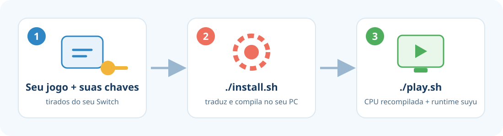

<p align="center">
  
</p>

# Tomodachi LTD Recomp

🇺🇸 [Read in English](README.md)

**Alpha: um port nativo não oficial de Tomodachi Life: Living the Dream para PC, gerado no seu computador a partir da sua própria cópia do jogo.** O código ARM do jogo é recompilado estaticamente para x86-64 e roda no **nxrt**, o runtime próprio deste projeto, com renderizador NVN → Vulkan próprio. Parte dos serviços do sistema Switch ainda vem de código derivado do suyu, então **não é uma reescrita do zero**.

O projeto **não contém o jogo, o firmware nem as chaves**. Você usa a **sua própria cópia** e o seu próprio `prod.keys`; o instalador gera tudo no seu PC. É um projeto de fãs, **sem afiliação com a Nintendo** nem com os criadores do jogo, feito para que fãs possam jogar e mexer nele.

> [!NOTE]
> **Status alpha.** Testado até agora em um notebook NVIDIA com Linux (Arch/EndeavourOS). GPUs AMD e Intel, outras distribuições e Windows não foram testados para o port nativo. Limitado a 30 FPS; há quedas breves para ~23 FPS enquanto uma cena nova carrega. Na primeira vez que abrir o editor de facepaint ele leva cerca de 40 segundos (prepara um cache no seu computador); as próximas aberturas levam poucos segundos.

> [!NOTE]
> **Para onde o projeto vai:** [docs/ROADMAP-RECOMPILER.pt-BR.md](docs/ROADMAP-RECOMPILER.pt-BR.md) (o nosso recompilador, passo a passo).

> [!NOTE]
> **Quer ajudar a testar?** Veja [`docs/TESTING.pt-BR.md`](docs/TESTING.pt-BR.md): o que foi testado e onde, o que ainda falta, como testar e como relatar problemas.

> [!WARNING]
> **Projeto educacional e experimental.** Use só com uma cópia do jogo que **você comprou** e extraiu do **seu próprio Switch**.
> Este projeto não tem ligação com a Nintendo, não distribui nenhum arquivo do jogo e não ajuda a obter jogos ou chaves por outros meios.
> Leia o [aviso legal completo](LEGAL.pt-BR.md).

<p align="center">
  
</p>

---

## O que você precisa

| | |
|---|---|
| 🖥️ **Sistema** | **Linux**, testado no Arch Linux / EndeavourOS. **Windows ainda não é suportado** (o port nativo é só para Linux por enquanto). |
| 🧠 **Memória** | **16 GB de RAM** e pelo menos **8 GB de swap** (memória virtual) |
| 💾 **Espaço livre** | **35 GB** |
| 🎮 **Placa de vídeo** | GPU com suporte a **Vulkan**; a compatibilidade não é garantida em todos os modelos ou drivers |
| 📦 **Seu jogo** | O arquivo **`.nsp`** do Tomodachi Life: Living the Dream, **versão 1.0.0, sem atualização** |
| 🔑 **Suas chaves** | O arquivo **`prod.keys`** do seu console |

> O jogo e as chaves precisam ser extraídos do **seu** Switch, com ferramentas próprias para isso. Este projeto não fornece esses arquivos.

---

> 🪟 **Está no Windows?** Pule para [Windows (experimental)](#windows-experimental). Os passos 1 a 4 abaixo são para Linux.

## Passo 1 — Preparar o computador

Abra o **Terminal**, cole o comando da sua distribuição Linux e aperte **Enter**. Ele vai pedir a sua senha.

**Arch Linux, EndeavourOS, Manjaro, CachyOS** (configuração do mantenedor no Arch/EndeavourOS; as outras variantes não foram verificadas independentemente):

```bash
sudo pacman -S --needed base-devel git cmake ninja clang python python-cryptography qt6-base qt6-svg qt6-5compat qt6-charts quazip-qt6 sdl3 ffmpeg opus zstd lz4 libusb openssl glslang nasm vulkan-icd-loader zenity
```

**Fedora** (relato positivo de um colaborador, não verificado pela CI; o pacote `ffmpeg` vem do RPM Fusion):

```bash
sudo dnf install git cmake ninja clang python3 python-cryptography qt6-qtbase qt6-qtsvg qt6-qt5compat qt6-qtcharts quazip-qt6 quazip-qt6-devel SDL3 ffmpeg opus zstd lz4 libusb openssl glslang nasm vulkan-loader zenity @development-tools qt6-qtsvg-devel qt6-qtcharts-devel SDL3-devel ffmpeg-free-devel qt6-qtbase-private-devel
```

Se a compilação parar com `Could NOT find FFmpeg` ou `Could NOT find Qt6GuiPrivate`, instale `ffmpeg-free-devel` e `qt6-qtbase-private-devel` (relatado na issue #7). `autoconf`, `libtoolize`, `libudev` e `systemd-devel` também foram usados por quem reportou, mas instale só se algum erro pedir.

**Ubuntu 25.04+, Debian 13+** (ainda não testado: se faltar algo, o instalador avisa o quê; conte numa issue para corrigirmos esta lista):

```bash
sudo apt install build-essential git cmake ninja-build clang python3 python3-cryptography qt6-base-dev qt6-base-private-dev qt6-svg-dev libqt6core5compat6-dev qt6-charts-dev libquazip1-qt6-dev libsdl3-dev libavcodec-dev libavfilter-dev libavutil-dev libswscale-dev libopus-dev libzstd-dev liblz4-dev libusb-1.0-0-dev libssl-dev glslang-tools nasm libvulkan-dev zenity
```

**Outras distribuições:** instale os equivalentes dos pacotes acima (as versões de desenvolvimento, "-devel"/"-dev", do Qt 6 com SVG, Charts e Qt5Compat, QuaZip para Qt 6, SDL3, FFmpeg, Opus, zstd, LZ4, libusb, OpenSSL e Vulkan, mais git, cmake, ninja, clang, Python 3 com `cryptography`, glslang, nasm e zenity). O instalador confere as ferramentas e diz quais estão faltando.

Isso instala os programas usados para montar o jogo. Só precisa ser feito uma vez.

---

## Passo 2 — Baixar este projeto

No mesmo Terminal:

```bash
git clone https://github.com/RussoPhone/tomodachi-ltd-recomp.git
cd tomodachi-ltd-recomp
```

> Se preferir, clique no botão verde **Code → Download ZIP** aqui no GitHub, extraia a pasta e abra o Terminal dentro dela.

---

## Passo 3 — Instalar

```bash
./install.sh
```

1. Uma janela pede o **arquivo do jogo (`.nsp`)**. Escolha e clique em OK.
2. Outra janela pede a **pasta onde está o seu `prod.keys`**. Escolha e clique em OK.
3. O instalador faz o resto sozinho e mostra o andamento em **11 passos**: prepara as ferramentas de extração, traduz o código do seu jogo para C, compila, extrai os dados do jogo e gera o runtime nativo (**nxrt**).

⏱️ **Reserve cerca de 2 horas** (medido num notebook de 16 threads com 16 GB de RAM; a maior parte é compilar o código do jogo, uns 100 minutos) e **~27 GB de disco**. Máquinas mais lentas demoram mais. O PC fica ocupado nesse tempo.

💡 **Precisou parar?** Feche o Terminal ou aperte `Ctrl+C`. Quando rodar `./install.sh` de novo, ele **continua de onde parou**.

No passo 7, uma janela da ferramenta de extração abre e fecha sozinha. **Não é o jogo**; não feche.

Se um passo falhar, o instalador salva um **relatório** (`local/logs/report-*.txt`, sem dados do jogo nem chaves) e diz onde ele está. Rode `./install.sh --report` para juntar todos os logs em um zip e anexar numa [issue](https://github.com/RussoPhone/tomodachi-ltd-recomp/issues).

No final, ele oferece um **atalho no menu de aplicativos**. Responda `Y` (ou `S`).

---

## Passo 4 — Jogar 🎉

Abra **Tomodachi Life** no menu de aplicativos, ou rode:

```bash
./play.sh
```

| Para… | Use |
|---|---|
| Abrir o launcher (padrão) | `./play.sh`: JOGAR, tela cheia, tamanho da janela, idioma, backup e restauração do save, relatório de bug |
| Iniciar o jogo direto | `./play.sh --nogui` |
| Tela cheia / tamanho da janela | `./play.sh --nogui --fullscreen`, `./play.sh --nogui --size 1920x1080` (F11 alterna a tela cheia no jogo) |
| Idioma do jogo | `./play.sh --nogui --language en-GB` (códigos: `ja`, `en-US`, `en-GB`, `fr`, `fr-CA`, `de`, `it`, `es`, `es-419`, `pt-BR`, `nl`, `ru`, `ko`, `zh-Hans`, `zh-Hant`; padrão `en-US`) |
| Investigar problemas | cada execução grava `local/logs/play-nxrt-*.log`; anexe aos relatórios de bug |

Os saves ficam em `local/user-nxrt` (dentro da pasta do projeto). Faça backup dessa pasta de vez em quando (o launcher tem o botão **Back up now**).

Depois de instalado, o jogo **não precisa mais do `.nsp` nem das chaves**. Tudo fica dentro da pasta do projeto.

---

## Perguntas frequentes

<details>
<summary><b>Como atualizar para uma versão nova?</b></summary>

Rode `git pull` na pasta existente e inicie o instalador novamente. Ele compara as impressões digitais de scripts, patches, adaptador e trava de versões upstream, e refaz as etapas afetadas e suas dependentes. **Uma atualização pode exigir nova exportação ou compilação demorada**, especialmente na primeira execução desta versão, pois os marcadores antigos ainda não têm essas impressões digitais. O cache pode reaproveitar objetos que não mudaram; a montagem do pacote preserva a pasta `user/` com os saves. Faça backup dos saves antes de atualizar.
</details>

<details>
<summary><b>Deu erro durante a instalação. E agora?</b></summary>

O instalador mostra qual passo falhou e onde está o registro completo (pasta `local/logs/`). Os erros mais comuns:
- **"Missing software"** (programas faltando): rode de novo o comando do Passo 1. A mensagem diz exatamente o que falta.
- **"Different version than the supported one"** (versão diferente): seu jogo tem uma atualização ou é outra versão. Por enquanto só a 1.0.0 funciona.
- **Falta de memória**: confira se você tem os 8 GB de swap. O instalador já limita o uso de RAM, mas abaixo disso não dá.

Corrigiu? É só rodar `./install.sh` de novo.
</details>

<details>
<summary><b>Onde ficam meus saves?</b></summary>

Em `local/user-nxrt`. Faça backup dessa pasta de vez em quando (o botão **Back up now** do launcher cria um zip em `local/backups`).
</details>

<details>
<summary><b>Posso usar o computador durante a instalação?</b></summary>

Pode, mas ele vai estar lento, porque a compilação usa quase toda a memória e o processador. Evite atualizar o sistema (`pacman -Syu`, `dnf upgrade`, `apt upgrade`) enquanto instala: trocar o compilador no meio obriga a compilar tudo de novo.
</details>

<details>
<summary><b>A compilação está muito lenta (KDE Plasma)</b></summary>

O indexador de arquivos do KDE (Baloo) tenta ler os gigabytes de código gerado e pode ocupar vários GB de RAM, deixando menos memória para compilar. Pause ele durante a instalação com `balooctl6 suspend` e religue depois com `balooctl6 resume`.
</details>

<details>
<summary><b>Como desinstalar?</b></summary>

Apague a pasta `tomodachi-ltd-recomp` e o atalho em `~/.local/share/applications/tomodachi-nxrt.desktop`. Os saves ficam dentro da pasta, então faça backup antes.
</details>

<details>
<summary><b>Como isso funciona por dentro?</b></summary>

Os jogos de Switch são feitos para o processador ARM do console. O instalador:
1. Lê o código de máquina ARM do **seu** jogo e o recompila estaticamente para C com o [mk8-recomp](https://github.com/dougchansan/mk8-recomp) (um recompilador baseado em código do suyu, usado só durante a instalação).
2. **Compila** o código gerado para o processador x86-64 do PC. Em execução **não há interpretador ARM nem JIT**: o código do jogo é código comum de PC.
3. **Gera o nxrt**, o runtime deste projeto, no seu computador. Ele implementa os serviços do sistema Switch que o jogo pede, e o **renderizador NVN → Vulkan** próprio desenha o jogo: os comandos da GPU são traduzidos para Vulkan, não emulados. Os shaders do jogo são traduzidos para SPIR-V com um tradutor derivado do do suyu.

O programa gerado no seu computador contém código do seu jogo, então **nunca é distribuído como binário** e não deve ser compartilhado. O C gerado é uma tradução automática, **não o código-fonte original do jogo**.
</details>

---

## Estado do projeto

🧪 **Alpha experimental.**

- ✅ **CPU:** o código do jogo é recompilado estaticamente para x86-64. Sem interpretador ARM e sem JIT em execução.
- ✅ **GPU:** o nxrt tem renderizador NVN → Vulkan próprio (sem emulação de comandos da GPU). Os shaders são traduzidos para SPIR-V.
- ℹ️ **O que ainda vem do suyu:** as ferramentas de extração e recompilação do instalador (suyu e mk8-recomp, usadas só durante a instalação) e partes do nxrt: o tradutor de shaders e parte do código dos serviços do sistema Switch são derivados do suyu. Estão creditados abaixo, sob GPL-3.0.
- 🧪 Testado até agora em uma máquina (EndeavourOS, Intel i5-13450HX, NVIDIA RTX 4050). Veja [docs/TESTING.pt-BR.md](docs/TESTING.pt-BR.md) para o que funciona, o que não foi testado e como ajudar.
- 🆕 Outras GPUs, distribuições e saves não foram testados, e uma instalação limpa em outro computador é a coisa mais útil que você pode tentar. Se um passo falhar, abra uma [issue](https://github.com/RussoPhone/tomodachi-ltd-recomp/issues) e anexe o relatório de `./install.sh --report`.
- 🐞 Pode haver bugs em partes do jogo que ninguém jogou ainda. Relate do mesmo jeito.

## Uso de IA e autoria

Este é um **projeto dirigido por uma pessoa, com uso substancial de IA generativa**. Ferramentas de IA foram usadas extensivamente para produzir e revisar código, patches, scripts de compilação e instalação, documentação e para auxiliar na depuração. Seria incorreto apresentar a implementação como inteiramente escrita à mão.

A pessoa responsável pelo projeto define sua direção e responde pelo que é publicado. Alterações geradas por IA podem conter erros, e **o código ainda não passou por uma auditoria manual independente e completa**. Correções, análises técnicas e relatos de bugs são bem-vindos.

## Verificações automáticas e limites

O [workflow Linux](.github/workflows/linux.yml) verifica sintaxe Python, sintaxe dos scripts shell, JSON de configuração e casos sintéticos em `unittest` para invalidação do instalador, headers no cache C, empacotamento e versões upstream. Esses testes rodam **sem jogo, chaves ou firmware**. O [workflow Windows](.github/workflows/windows.yml) tenta compilar o backend sem arquivos do jogo.

**Nenhum dos dois workflows comprova que o jogo completo instala ou roda corretamente.** Gameplay, compatibilidade de GPU/driver, preservação de saves em atualizações reais e instalação completa no Windows exigem verificações separadas em hardware real.

## Créditos e licença

- [**mk8-recomp**](https://github.com/dougchansan/mk8-recomp) e o fork do **suyu**: o motor de recompilação e o ambiente de execução. O suyu é derivado do yuzu.
- Este projeto: integração, instalador, patches e suporte ao Tomodachi Life: Living the Dream, desenvolvidos com uso substancial de IA, conforme informado acima.

Licenciado sob a **GPL-3.0-or-later** (veja [`LICENSE`](LICENSE)), a mesma do suyu.

*Tomodachi Life e Nintendo Switch são marcas registradas da Nintendo. Este projeto não tem relação com a Nintendo nem é endossado por ela.*
