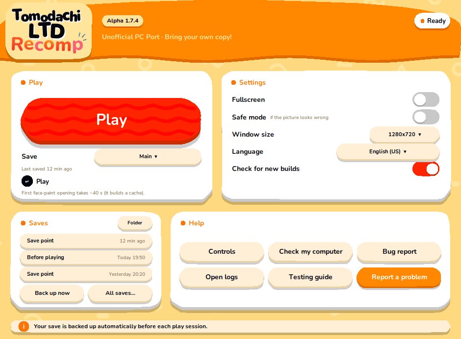

# The launcher

`./play.sh` opens a small window (the launcher) before the game. You can also search for **Tomodachi LTD Recomp** in your applications menu.

- No window available (a terminal-only session, or Python without Tk)? `./play.sh` starts the game directly. `./play.sh --nogui` always does.
- The launcher could not open? It says why and tells you to use `./play.sh --nogui`. If you report it, attach the text it printed.
- Menu entry: the installer offers it. Add or remove it later with `./play.sh --shortcut` and `./play.sh --remove-shortcut`.

## The window

| Part | What it does |
|---|---|
| **Play** | Starts the game with your settings. Enter does the same. The window steps aside while you play and comes back when the game closes. |
| **Save** | Which save to play (see [Saves](#saves)). The launcher opens on the one you played last. |
| **Settings** | Fullscreen, Safe mode (a slower, more careful graphics path: use it if the picture looks wrong), window size, language, and *Check for new builds*. |
| **Saves** | The three newest saves, **Back up now**, **All saves…** and **Folder**. |
| **Help** | The controls sheet (Keyboard, Mouse, Controller), *Check my computer*, a bug report (logs and a system summary, no game data or keys), the logs folder, the testing guide and the issue form. |

### Language

Only the 13 languages the game really has text for: English (US and UK), Japanese, French (France and Canada), German, Italian, Spanish (Spain and Latin America), Dutch, Korean, Simplified and Traditional Chinese. Portuguese and Russian are **not** in the game: choosing them used to show English silently, so they are gone. A language saved by an older launcher that the game does not have goes back to English (US), and the launcher says so.

### Build version and the new-build notice

The chip next to the logo is the version of the build that is **installed**. It is read from the program itself (`local/nxrt/bin/nxrt`), not from the source code, so it is right even when the source folder is newer than what you built. If it cannot be read, no version is shown rather than a guess.

When a newer release exists on GitHub, a yellow chip says so (for example *Alpha 1.7.4 available*). Click it for what changed and how to update (`git pull`, then `./install.sh` again; updating can mean a long rebuild). **The launcher never updates anything by itself.**

- It asks GitHub for the list of releases, read-only, at most once every 6 hours, in the background. A start never waits for it and being offline changes nothing. Like any web request it reveals your IP address to GitHub; nothing else about your computer is sent.
- Turn it off with **Check for new builds** in Settings.

## Saves

The game keeps its save in a folder. The launcher can keep **several**, each with a name:

- **Main** is the save you already had, in `local/user-nxrt`. It is never moved.
- **+ New save…** (in the *Save* list) starts a fresh game in its own folder (`local/profiles/<name>`). The others stay untouched. *Rename this save…* is in the same list.
- **Play** uses the save shown. The launcher opens on the one you **played last**.

Every copy has a readable name and time instead of a file name:

| Name | When it is made |
|---|---|
| **Before playing** | Each time you press Play (the last 10 are kept per save) |
| **Save point** | While you play, when the game has written a save and then gone quiet (at most one every 3 minutes; the last 20 are kept per save) |
| **End of session** | When you close the game, if the save changed since the last point |
| **Backup** | *Back up now*. It asks for a name (you can leave it empty). Never deleted automatically |
| **Before restore** | Every restore first saves the current state, so you can undo it |

A copy you named yourself is never deleted automatically.

The three newest copies are on the main window: click one to go back to it. **All saves…** lists everything with **Restore**, **Rename** and **Delete**.

### What it can and cannot protect

The game writes its save only when **you save inside the game**. What you did since your last in-game save exists only in the game's memory, so no copy of the folder can contain it. Closing the window with Alt+F4 or killing the task loses it, and the launcher cannot bring it back. (A normal close and Alt+F4 both end with exit code 0, so the launcher cannot tell them apart either.)

What the launcher does for you:

- it keeps copies of what the game **did** write, so an overwrite you regret, or a save cut in half because the game was killed while writing, can be undone;
- when the game closes it says how long before closing your last save was (*Your last save in the game was 47 min before you closed it. Anything after it is lost.*), and, if the game was killed right after writing, offers to go back to the previous copy.

## Files it uses

| File | What |
|---|---|
| `local/launcher.json` | Your settings |
| `local/profiles.json`, `local/profiles/` | The names of your saves and the folders of the extra ones |
| `local/backups/` (and `index.json` in it) | The copies above |
| `local/update-check.json` | The last answer from GitHub (so the next start does not wait) |

Delete any of them if you want to start over; the game data in `local/user-nxrt` is separate.

## Problems

- **The window does not open** → `./play.sh --nogui`. On Debian/Ubuntu the window needs `python3-tk`.
- **The picture looks wrong** → Settings → *Safe mode*, or `./play.sh --nogui --safe`.
- **"Not installed"** → run `./install.sh` first.
- **Anything else** → *Bug report* in Help makes a zip with logs (no game data or keys) to attach to an [issue](https://github.com/RussoPhone/tomodachi-ltd-recomp/issues).
