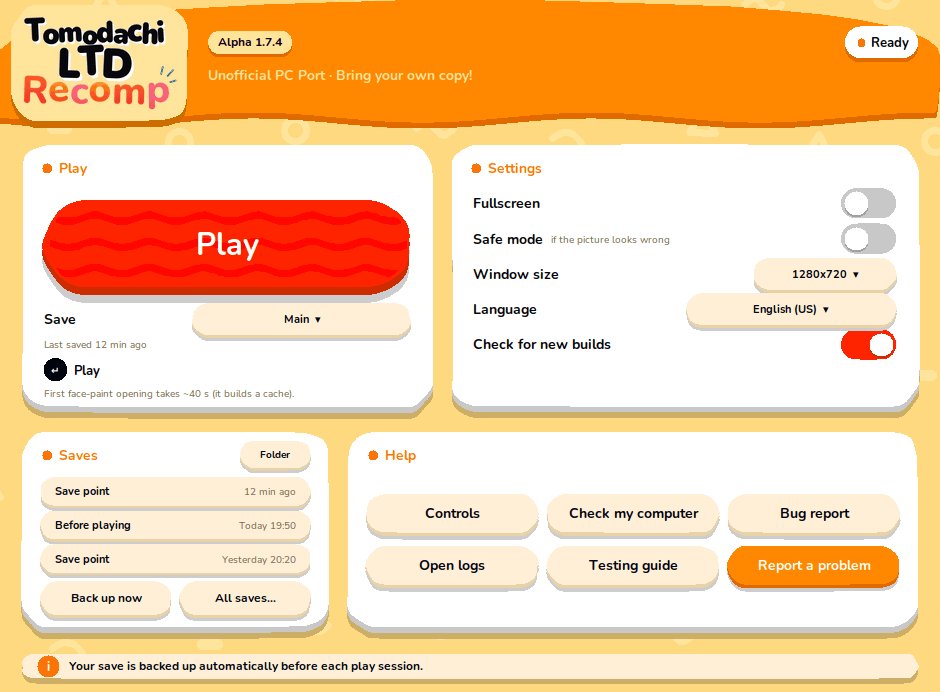

# O launcher

O `./play.sh` abre uma janelinha (o launcher) antes do jogo. Você também pode procurar **Tomodachi LTD Recomp** no menu de aplicativos.

- Sem janela disponível (sessão só de terminal, ou Python sem Tk)? O `./play.sh` inicia o jogo direto. O `./play.sh --nogui` sempre faz isso.
- O launcher não conseguiu abrir? Ele diz o motivo e manda usar `./play.sh --nogui`. Se for reportar, anexe o texto que ele mostrou.
- Entrada no menu: o instalador oferece. Adicione ou remova depois com `./play.sh --shortcut` e `./play.sh --remove-shortcut`.

## A janela

| Parte | O que faz |
|---|---|
| **Play** | Inicia o jogo com as suas opções. O Enter faz o mesmo. A janela sai da frente enquanto você joga e volta quando o jogo fecha. |
| **Save** | Qual save jogar (veja [Saves](#saves)). O launcher abre no que você jogou por último. |
| **Settings** | Tela cheia, modo seguro (caminho gráfico mais lento e cuidadoso: use se a imagem estiver errada), tamanho da janela, idioma e *Check for new builds*. |
| **Saves** | Os três saves mais novos, **Back up now**, **All saves…** e **Folder**. |
| **Help** | A folha de controles (Teclado, Mouse, Controle), *Check my computer*, o relatório de bug (logs e resumo do sistema, sem dados do jogo nem chaves), a pasta de logs, o guia de testes e o formulário de issues. |

### Idioma

Só os 13 idiomas para os quais o jogo realmente tem texto: inglês (EUA e Reino Unido), japonês, francês (França e Canadá), alemão, italiano, espanhol (Espanha e América Latina), holandês, coreano, chinês simplificado e tradicional. Português e russo **não** existem no jogo: escolhê-los mostrava inglês sem avisar, então saíram da lista. Um idioma salvo por um launcher antigo que o jogo não tem volta para inglês (EUA), e o launcher avisa.

### Versão da build e o aviso de build nova

O selo ao lado do logo é a versão da build **instalada**. Ela é lida do próprio programa (`local/nxrt/bin/nxrt`), e não do código-fonte, então está certa mesmo quando a pasta do código é mais nova do que o que você compilou. Se não der para ler, nenhuma versão aparece, em vez de um chute.

Quando existe uma release mais nova no GitHub, um selo amarelo avisa (por exemplo, *Alpha 1.7.4 available*). Clique nele para ver o que mudou e como atualizar (`git pull` e depois `./install.sh` de novo; atualizar pode significar uma recompilação longa). **O launcher nunca atualiza nada sozinho.**

- Ele pede ao GitHub a lista de releases, só leitura, no máximo uma vez a cada 6 horas e em segundo plano. Abrir o launcher nunca espera por isso, e estar sem internet não muda nada. Como qualquer requisição web, isso mostra o seu endereço IP ao GitHub; nada mais sobre o seu computador é enviado.
- Desligue em **Check for new builds**, nas configurações.

## Saves

O jogo guarda o save numa pasta. O launcher pode guardar **vários**, cada um com um nome:

- **Main** é o save que você já tinha, em `local/user-nxrt`. Ele nunca é movido.
- **+ New save…** (na lista *Save*) começa um jogo novo numa pasta própria (`local/profiles/<nome>`). Os outros ficam intocados. *Rename this save…* está na mesma lista.
- O **Play** usa o save mostrado. O launcher abre no que você **jogou por último**.

Toda cópia tem nome e hora legíveis, em vez de nome de arquivo:

| Nome | Quando é feita |
|---|---|
| **Before playing** | Cada vez que você aperta Play (as últimas 10 ficam, por save) |
| **Save point** | Enquanto você joga, quando o jogo gravou um save e depois ficou quieto (no máximo uma a cada 3 minutos; as últimas 20 ficam, por save) |
| **End of session** | Quando você fecha o jogo, se o save mudou desde o último ponto |
| **Backup** | *Back up now*. Pede um nome (pode deixar vazio). Nunca é apagado sozinho |
| **Before restore** | Toda restauração antes salva o estado atual, para você poder desfazer |

Uma cópia que você nomeou nunca é apagada automaticamente.

As três cópias mais novas ficam na janela principal: clique numa para voltar a ela. **All saves…** lista tudo, com **Restore**, **Rename** e **Delete**.

### O que ele protege e o que não protege

O jogo só grava o save quando **você salva dentro do jogo**. O que você fez depois do último save no jogo existe só na memória do jogo, então nenhuma cópia da pasta pode conter isso. Fechar a janela com Alt+F4 ou matar a tarefa perde esse trecho, e o launcher não consegue trazê-lo de volta. (Um fechamento normal e o Alt+F4 terminam com o mesmo código de saída, 0, então o launcher também não consegue diferenciá-los.)

O que o launcher faz por você:

- guarda cópias do que o jogo **chegou a gravar**, então dá para desfazer uma sobrescrita de que você se arrependa, ou um save cortado no meio porque o jogo foi morto durante a gravação;
- quando o jogo fecha, diz quanto tempo antes de você fechar foi o seu último save (*Your last save in the game was 47 min before you closed it. Anything after it is lost.*) e, se o jogo foi morto logo depois de gravar, oferece voltar à cópia anterior.

## Arquivos que ele usa

| Arquivo | O quê |
|---|---|
| `local/launcher.json` | As suas opções |
| `local/profiles.json`, `local/profiles/` | Os nomes dos seus saves e as pastas dos extras |
| `local/backups/` (e o `index.json` dentro dela) | As cópias acima |
| `local/update-check.json` | A última resposta do GitHub (para a próxima abertura não esperar) |

Apague qualquer um se quiser recomeçar; os dados do jogo em `local/user-nxrt` são separados.

## Problemas

- **A janela não abre** → `./play.sh --nogui`. No Debian/Ubuntu a janela precisa do `python3-tk`.
- **A imagem está errada** → Settings → *Safe mode*, ou `./play.sh --nogui --safe`.
- **"Not installed"** → rode o `./install.sh` primeiro.
- **Qualquer outra coisa** → *Bug report*, em Help, gera um zip com os logs (sem dados do jogo nem chaves) para anexar a uma [issue](https://github.com/RussoPhone/tomodachi-ltd-recomp/issues).
